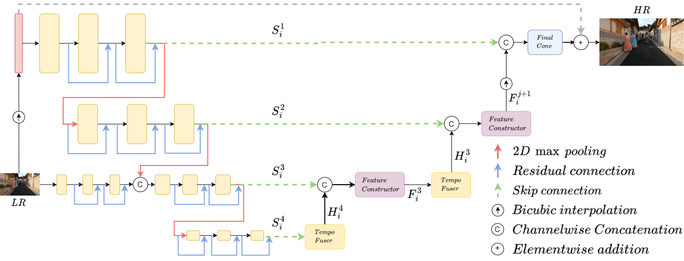

# Fork-Net architecture

Fork-Net is a U-Net for ×4 video super-resolution whose decoder carries bidirectional, second-order
recurrent propagation (the "fork"). Code: [`forknet/archs/forknet.py`](../forknet/archs/forknet.py).
Attribute names in parentheses are the module names in the code and in checkpoints.

*Fig. 1 of the paper. The encoder runs on the bicubic-upsampled frame and receives LR features at LR resolution; the
decoder propagates features bidirectionally at ½× and 1× LR resolution (Tempo Fusers) and fuses them with encoder
skips (Feature Constructors) before a global bicubic skip.*

The labels in the figure map to the code as follows; shapes are for one 64×64 LR frame with C = `num_feat` = 64.

| Figure | Module | Output shape |
|---|---|---|
| S¹ | `conv_1` (2 U-Net blocks) on the bicubic ×4 frame | (C, 256, 256) |
| S² | `conv_2` (2 U-Net blocks) after max pooling | (C, 128, 128) |
| S³ | `conv_3_pre_net` on the LR frame, concatenated with the pooled features, then `conv_3` | (2C, 64, 64) |
| S⁴ | `conv_4` after max pooling | (2C, 32, 32) |
| H⁴ | Tempo Fuser at ½× (`tempo_fuser_32`) | (2C, 64, 64) |
| F³ | Feature Constructor (`skip_fuse_64`) on [H⁴, S³] | (2C, 64, 64) |
| H³ | Tempo Fuser at 1× (`tempo_fuser_64`) | (C, 128, 128) |
| Fj+1 | Feature Constructor (`skip_fuse_128`) on [H³, S²], then PixelShuffle | (C, 256, 256) |
| Final Conv | `final_conv` on [Fj+1, S¹], plus the bicubic ×4 frame | (3, 256, 256) |

## Components

**U-Net block** (`UNetBlock`): BSConv 3×3 → ReLU → BSConv 3×3, with identity shortcut when
input and output channels match. Encoder stages: `conv_1`, `conv_2` (2 blocks), `conv_3_pre_net`,
`conv_3`, `conv_4` (`num_encoder_blocks` = 3 blocks).

**LR feature injection**: the encoder runs on the bicubic-upsampled frame (as in the ISR model
cited in the paper). Features computed directly from the LR frame (`conv_3_pre_net`) are
concatenated at LR resolution, so the network sees the input twice.

**Tempo Fuser** (`TempoFuser`, Eqs. 1–3), applied at ½× and 1× LR resolution:

* forward branch (`res_forward`), for t = 0 … T−1:
  `h_fwd[t] = A_fwd([W(h_fwd[t−2], f_{t−2→t}), W(h_fwd[t−1], f_{t−1→t}), F[t]])`
* backward branch (`res_backward`), for t = T−1 … 0:
  `h_bwd[t] = A_bwd([F[t], W(h_bwd[t+1], f_{t+1→t}), W(h_bwd[t+2], f_{t+2→t})])`
* `A_*` = BSConv 3×3 (3C→C) → LeakyReLU(0.1) → (`num_prop_blocks` − 1) = 4 ConvNeXt-style blocks
* fusion (`fuse_net`): BSConv 3×3 on `[h_fwd, h_bwd]` (2C→C); upsampling (`up_net`): BSConv 3×3 then PixelShuffle(2)
* `W` = backward warping (`flow_warp`, bilinear, zero padding, flow clamped to ±100 px)
* missing neighbours at sequence ends are zeros; first-order propagation (`prop_order: 1`)
  drops the t±2 terms.

**ConvNeXt-style block** (`ConvNeXtBlock`): depthwise 3×3 → 1×1 (4× expansion) → GELU → 1×1, plus identity.

**Feature Constructor** (`FeatureConstructor`, Eq. 4): BSConv 3×3 → ReLU → BSConv 3×3 → ReLU.

**Optical flow**: SpyNet (BasicSR weights, `weights/spynet_sintel_final-3d2a1287.pth`) on LR frames,
for pairs (t, t±1) and (t, t±2). Flows are bilinearly resized and rescaled for the ½× level.

**Blueprint-separable convolution** (`BSConvU`): bias-free 1×1 pointwise conv followed by a
3×3 depthwise conv (Haase & Amthor, 2020), replacing every 3×3 convolution except the ConvNeXt
blocks, SpyNet and the final convolution.

## Configuration

All switches live in `ForkNetConfig` (YAML key `model`):

| key | default | meaning |
|---|---|---|
| `num_feat` | 64 | C |
| `num_encoder_blocks` | 3 | blocks in `conv_3_pre_net`, `conv_3`, `conv_4` |
| `num_prop_blocks` | 5 | entry conv + 4 aggregation blocks per branch |
| `prop_order` | 2 | 1 or 2 |
| `prop_block` | `convnext` | `convnext` or `resblock` |
| `use_bsconv` | true | BSConv vs. standard 3×3 convolutions |
| `bsconv_fusion` | = `use_bsconv` | BSConv for `fuse_net` / `up_net` |
| `fuse_with_input` | false | also concatenate `F[t]` into the fusion (variant from the original code) |
| `bottleneck_mult` | 2 | channels of S⁴ = mult × C |
| `legacy_flow_direction`, `legacy_backward_index`, `legacy_flow_scaling` | false | reproduce the original flow direction, backward indexing and flow scaling |

Inputs whose LR height or width is odd are replicate-padded by one pixel and the output is
cropped. SpyNet internally resizes inputs smaller than 64 px up to 64 px.
